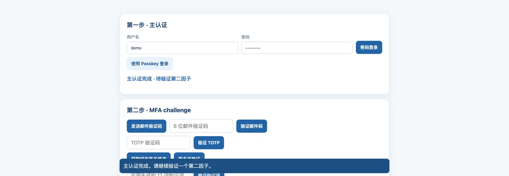
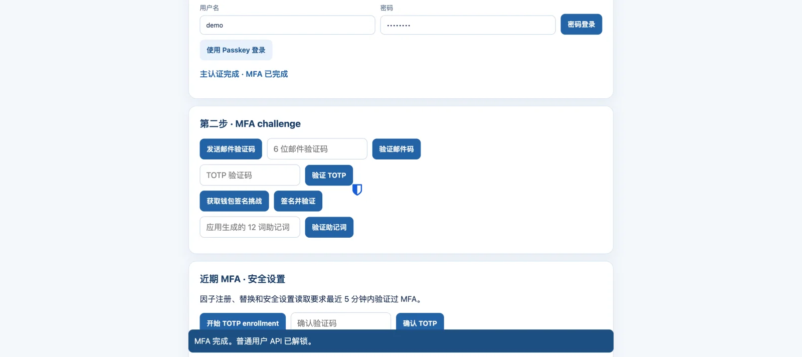

# Spring Security 7 MFA Demo

[](https://openjdk.org/projects/jdk/25/)
[](https://spring.io/projects/spring-boot)
[](https://spring.io/projects/spring-security)
[](https://maven.apache.org/)
[](LICENSE)

[简体中文](README.zh-CN.md) | English

A browser-based, two-step authentication demo built with Spring Boot 4.1.2, Spring Security 7, Java 25, and Maven. It demonstrates Spring Security 7 MFA support, combining password or passkey primary authentication with TOTP, development-only email OTP, EIP-191 wallet signatures, or an application-specific BIP-39 mnemonic. Accounts and factor state are kept in memory; no database is used.

> For local development and learning only. The demo account, console-delivered email codes, and relying-party settings are not production-ready. Do not expose this app to the public internet.

## Run locally

JDK 25 is required:

```bash
./mvnw spring-boot:run
```

Open <http://localhost:8080/> and sign in with `demo` / `changeit`. State is in memory and is cleared when the app restarts.


## Authentication flow and security boundaries

Primary authentication uses a password or a Spring Security WebAuthn passkey assertion. After primary authentication, the user must verify an enrolled second factor: TOTP, development-only email OTP, EIP-191 wallet signature, or an application-specific BIP-39 mnemonic. The app enables Spring Security MFA with `@EnableMultiFactorAuthentication(authorities = {})`; app-specific authorization rules enforce the primary-plus-second-factor flow, and the server adds factor authorities only after verification. MFA state is held in the server-side Spring Security session. Request bodies and custom headers cannot grant roles or MFA state. Protected resources remain unavailable until the second factor succeeds. The session flow retains CSRF protection; write requests must send the header and token returned by `GET /api/auth/csrf`.

After primary authentication, protected APIs remain locked until the second factor is verified:



After successful MFA verification, the protected user API becomes available:



Factor management, passkey registration, and security-status reads require MFA completed within the last five minutes. The demo supports managing TOTP, wallet-signature, and mnemonic factors; it does not provide one-time recovery codes. It implements a two-step flow but does not assess whether the selected factors belong to distinct categories or whether a passkey performed user verification, so not every combination necessarily meets a strict MFA assurance policy. API errors use RFC 9457 `application/problem+json`.

## API contract

The app uses same-origin HTTP endpoints, JSON bodies for API calls, and a server-side `JSESSIONID` session. Fetch the CSRF token from `GET /api/auth/csrf`. Primary password login is `POST /api/auth/login` with form fields `username` and `password`; passkey login uses Spring Security WebAuthn endpoints. After primary login, request a challenge when needed with `POST /api/auth/mfa/challenge` (for example, `{"factorType":"EMAIL_OTP"}`), then submit the factor proof to `POST /api/auth/mfa/verify` (for example, `{"factorType":"TOTP","proof":"123456"}`).

| Method and path | Contract | Access requirement |
| --- | --- | --- |
| `POST /api/auth/login` | Form fields `username`, `password` | Public primary login |
| `POST /login/webauthn` | WebAuthn assertion JSON | Public passkey primary login |
| `POST /webauthn/authenticate/options` | Starts a passkey assertion ceremony | Public primary login |
| `GET /api/auth/csrf` | Returns `headerName` and `token` for subsequent writes | Public bootstrap |
| `GET /api/auth/state` | Returns `primaryAuthenticated`, `mfaComplete`, and `username` | Public bootstrap |
| `POST /api/auth/mfa/challenge` | JSON `{ "factorType": "EMAIL_OTP" }` or `WALLET_SIGNATURE`; TOTP, mnemonic, and WebAuthn need no separate challenge | Primary login |
| `POST /api/auth/mfa/verify` | JSON `{ "factorType": "TOTP", "proof": "..." }`; also accepts `EMAIL_OTP`, `WALLET_SIGNATURE`, or `BIP39_MNEMONIC` | Primary login |
| `GET /api/me` | Returns the current demo user and protected-resource message | Primary login and MFA complete |
| `GET /api/me/security` | Returns security status | MFA completed within five minutes |
| `GET /api/mfa/factors` | Returns enrolled factors | Recent MFA, within five minutes |
| `DELETE /api/mfa/factors/{factorType}` | Removes `TOTP`, `WALLET_SIGNATURE`, or `BIP39_MNEMONIC`; returns `204` | Recent MFA, within five minutes |
| `POST /api/mfa/totp/enroll` | No body; returns the TOTP secret and `otpauthUri` | Recent MFA, within five minutes |
| `POST /api/mfa/totp/confirm` | JSON `{ "code": "123456" }` | Recent MFA, within five minutes |
| `POST /api/mfa/wallet/enroll` | JSON `{ "address": "0x..." }`; returns a signing challenge | Recent MFA, within five minutes |
| `POST /api/mfa/wallet/confirm` | JSON `{ "signature": "0x..." }` | Recent MFA, within five minutes |
| `POST /api/mfa/mnemonic/enroll` | No body; returns a one-time displayed application mnemonic | Recent MFA, within five minutes |
| `POST /webauthn/register/options`, `POST /webauthn/register` | WebAuthn registration ceremony | Recent MFA, within five minutes |
| `POST /logout` | Invalidates the current session, if present | Any session |

All state-changing requests, including login and logout, must send the CSRF token using the header name returned by `GET /api/auth/csrf`; keep the same session cookie. Invalid or expired proofs and other invalid input return `400`; state conflicts such as removing an unenrolled factor return `409`. Unauthenticated requests return `401`, and requests without the required authentication stage return `403`. These errors use `application/problem+json`. OpenAPI provides endpoint documentation and available schemas in [OpenAPI JSON](http://localhost:8080/v3/api-docs) and [Swagger UI](http://localhost:8080/swagger-ui/index.html). These documentation endpoints are anonymous in this local demo; protect or disable them in production.

### Factors

- **Email OTP:** Printed only to local application logs. Codes expire after five minutes, are single-use, allow at most five failed attempts, and are replaced when reissued. Production use needs a mail provider, verified addresses, and rate limiting.
- **TOTP:** After recent MFA, call `POST /api/mfa/totp/enroll` for a secret and `otpauth` URI. Add it to an authenticator, then confirm with `POST /api/mfa/totp/confirm`. Verification accepts a ±1 30-second time step and rejects reuse of an accepted step. Encrypt secrets at rest in production.
- **Passkey:** Registration and assertion login use Spring Security WebAuthn. A second factor is still required after passkey primary authentication. The demo RP ID is `localhost`, with `http://localhost:8080` as the allowed origin; browsers require localhost or HTTPS.
- **Wallet signature:** web3j verifies EIP-191 `personal_sign`. Challenges are bound to the account and session and consumed after success to prevent replay. Demo domain, URI, and validation policy are for local use only.
- **BIP-39 mnemonic:** The app generates a 12-word application credential using a CSPRNG, displays it once, and stores its SHA-256 digest. It can be reused for MFA and is not a one-time recovery code. It is a bearer secret, not phishing-resistant. Never enter it into a wallet or submit an existing wallet mnemonic; the app does not derive keys from it.

## Production considerations

A production system still needs durable, access-controlled storage, encrypted TOTP secrets, persistent WebAuthn credentials, a real mail service, rate limiting and audit, HTTPS and secure cookies, correct RP ID/origin settings, SIWE policy validation, and factor revocation, recovery, and rotation procedures. The in-memory account and credential stores, demo password, console OTP, and development RP configuration must not be used as-is in production.

## License

This project is licensed under the Apache License 2.0. See [LICENSE](LICENSE) for the full terms.
